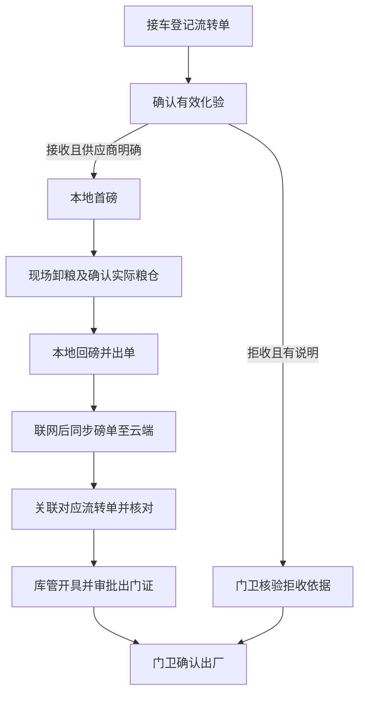

# 原粮入厂一期：状态流转与验收场景

状态：开发规格草案，2026-11-06。磅房离线方式已按用户确认调整：本地称重，联网后同步磅单到云端，再关联对应流转单。业务规则见[主规格](grain-intake-spec.md)，接口见[协同接口](grain-intake-collaboration-api.md)。

## 1. 本地事实与云端进度

图中表达业务先后，不要求每步都实时回传云端。磅房断网时可以完成本地称重和出单；云端在同步关联前可能不知道首磅或回磅已经发生，界面必须明确这种滞后。

流转单云端阶段建议为待化验、接收待关联磅单、待开证、待放行、拒收待出厂、已出厂。实际粮仓与卸粮确认、已同步未关联磅单、异常阻断分别记录；不能只用一个阶段字段替代事实检查。

## 2. 操作及前置条件

| 操作 | 操作人 | 条件与结果 |
| --- | --- | --- |
| 登记流转单 | 库管 | 车牌、粮种必填；供应商可待核实；生成独立本趟编号 |
| 补选供应商 | 授权采购/化验员等 | 正式接收前明确供应商；更正留痕，不覆盖历史依据 |
| 记录检测/复检 | 有权限化验员 | 保留历次结果；首磅前确认最终有效结果 |
| 确认有效化验 | 化验员 | 接收须供应商明确；拒收须说明；偏离建议填写原因 |
| 本地首磅 | 库管 | 业务上已确认接收及有效化验；本地保存实际称重时间和所用依据，不等待云端在线准备 |
| 确认卸粮 | 库管 | 现场首磅已完成，检查实际粮仓及卸粮完成；不要求首磅已回传云端 |
| 本地回磅、出单 | 库管 | 业务上已确认实际粮仓及卸粮；本地完成两次称重、计算和打印，断网不阻止保存 |
| 同步正式磅单 | 厂端 | 联网后按既有协议同步，重复上传不产生重复单据 |
| 关联磅单 | 授权库管或后续确定的厂端调用 | 云端已有有效磅单；本趟和磅单唯一关联，核对化验依据、重量及卸粮事实 |
| 开具、审批出门证 | 库管 | 实际粮仓已记录、卸粮已确认、两次称重完成且有效磅单已关联；无冲突阻断 |
| 确认正常出厂 | 门卫 | 正常证已审批，依据仍有效；原子保存唯一出厂记录 |
| 确认拒收出厂 | 门卫 | 有效拒收结果及说明完整；无需完整磅单或正常出门证；原子保存唯一出厂记录 |

本地称重与云端状态分离不取消业务前置条件。离线期间化验依据怎样交给磅房、现场首磅怎样证明、卸粮确认怎样传达，需在联调规格中确定，不凭空规定人工填写或缓存已具备。

## 3. 一致性与阻断

- 不再设置必须先调用云端的首磅/回磅准备锁。云端无法仅靠本地状态实时禁止离线首磅后的复检；同步关联时核对实际首磅时间和有效化验版本，发现事后更改则阻断开证，保留两端事实待核查。
- 卸粮确认可以依据现场已首磅事实办理，不以首磅回传成功为条件。现场确认的记录方式在实现时细化，不允许用同步到达时间冒充称重时间。
- 粮仓预指定不能代替实际卸粮确认；停用不改写历史，新确认不得选择停用粮仓。
- 磅单未同步、未关联、已作废或与流转单不一致时，不得正常开证。关联失败不影响已保存的本地磅单，不重出单或自动改挂另一趟。
- 审批前更正供应商/粮仓须授权留痕；影响既有磅单的更正不能只改云端。审批后及出厂后联动更正不在一期。
- 化验改判与门卫拒收放行在云端按流转单版本及事务检查；迟到磅单若与已拒收出厂事实冲突，保留异常，不自动改成正常收粮。
- 本地未上传的作废仍可能使云端暂时看见有效单，放行期间的有效性保证另行确认，见接口规格。

## 4. 验收场景

| 场景 | 应有结果 |
| --- | --- |
| 同车一天送两次 | 两张流转单，磅单按明确编号关联，不凭车牌自动串单 |
| 供应商待核实或合同编号为空 | 前者阻止正式接收；后者不阻断流程 |
| 磅房断网 | 本地正常称重出单；云端不能冒充已收到磅单 |
| 首磅未回传，库管现场确认卸粮 | 不因缺少首磅云端回执而阻断；保留现场确认事实 |
| 恢复联网 | 先同步正式磅单，再关联对应流转单；校验通过后才具备开证条件 |
| 同步成功但关联失败或回执丢失 | 原磅单保留，按原关联请求查询或重试，不重复出单 |
| 同一单关联两趟或同一趟重复关联 | 冲突拒绝或返回原结果，不重复累计 |
| 离线首磅后云端重新确认化验 | 关联时发现时间/版本冲突，阻断开证，不能静默按新结果覆盖 |
| 实际净重20吨、扣减0.4吨 | 实际净重20吨、扣减后19.6吨分别展示 |
| 拒收无磅单、无正常出门证 | 门卫核验拒收依据可确认出厂，不计正常台账 |
| 已审批但门卫未确认 | 仍为待放行，不展示已出厂 |
| 门卫并发确认或超时重试 | 每趟仅一条出厂记录 |
| 关联错粮种、供应商、化验依据或重量 | 不自动覆盖，提示核查并阻断开证 |
| 未授权岗位直接调用写接口 | 后端拒绝 |

以上为后续验收依据，本次未执行业务测试。
