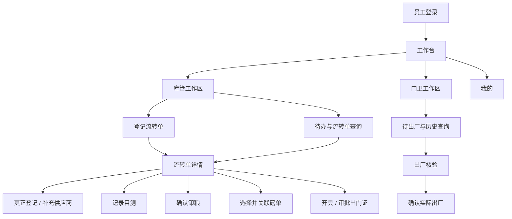
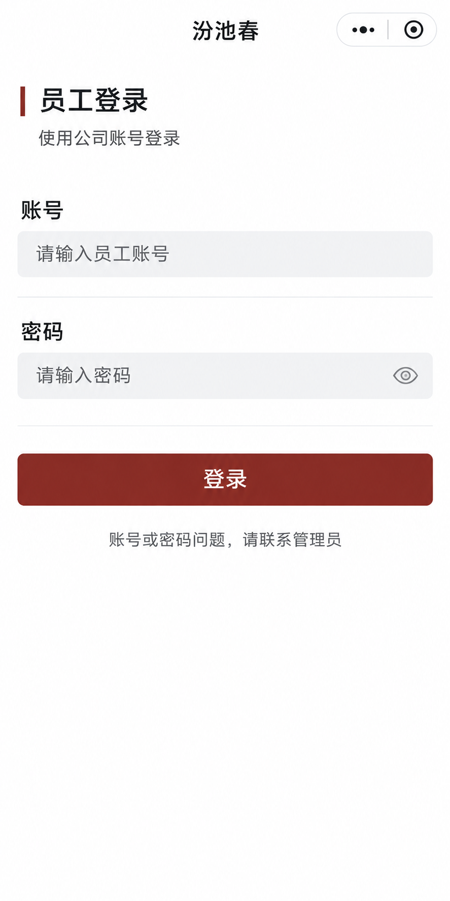
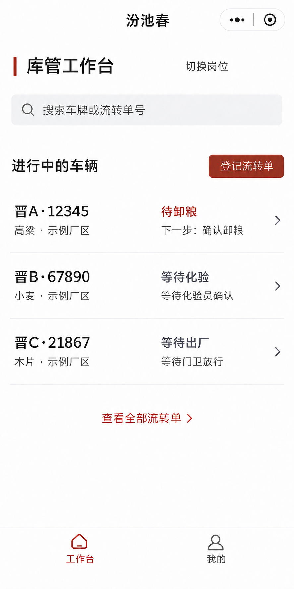
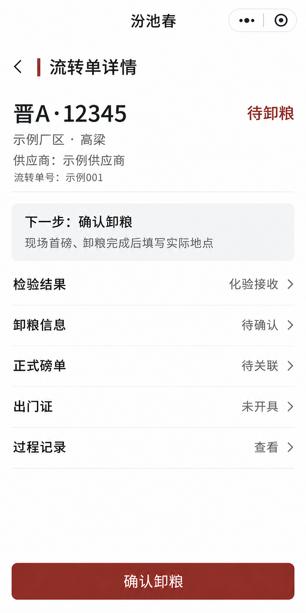
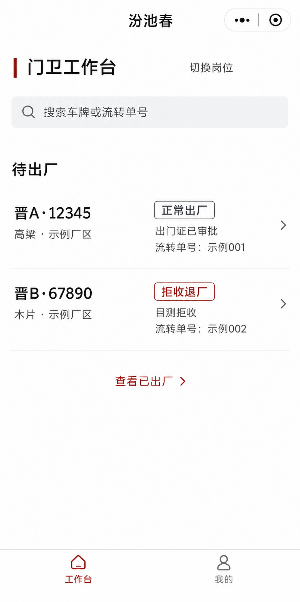
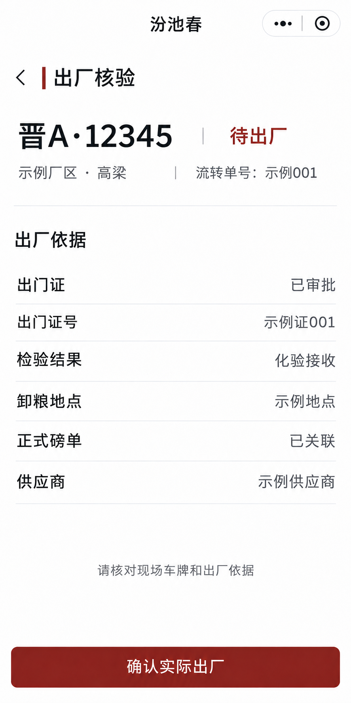

# 原粮入厂小程序：页面规划与线框

状态：设计讨论中，岗位工作区、状态引导、库管统一列表、简洁视觉方向和底部导航已确认；各页面细节继续评审。2026-11-09。

范围依据：[首批实施方案](miniprogram-grain-intake-plan.md)。库管和门卫都在首批范围，覆盖化验、目测、正常出厂和拒收退厂；化验录入、称重和磅单生成继续在现有系统完成。下方车牌、名称和数量均为虚构示例。

## 1. 设计目标

让现场人员先找到当前车辆，再看清下一步该做什么。车牌、厂区、货品和业务状态优先于单号与次要资料；确认放行时必须能够看到本趟出厂依据。页面围绕手机单手操作和现场快速核对设计，同时保留查看完整依据的入口。

除明确标记已确认的部分外，本稿页面布局与视觉样式均为建议；业务边界以已确认方案和现有业务规则为准。

## 2. 页面地图



上图描述信息和操作入口，不预设每个节点必须是独立页面。短表单可以采用底部弹层，磅单候选和完整详情适合独立页面；需留意手机键盘和底部安全区。

| 页面或界面 | 主要对象 | 核心任务 |
| --- | --- | --- |
| 员工登录 | 全部员工 | 输入账号密码，进入工作台 |
| 工作台 / 库管工作区 | 库管 | 查看待办、登记、查询车辆 |
| 登记 / 更正 | 库管 | 登记本趟，必要时补充供应商或更正允许更正的信息 |
| 流转单详情 | 库管 | 核对本趟、检验、卸粮、磅单和出门证，办理下一步 |
| 磅单候选 | 库管 | 对比正式磅单并关联本趟 |
| 工作台 / 门卫工作区 | 门卫 | 查找待出厂车辆，进入具体一趟 |
| 出厂核验 | 门卫 | 核对现场车辆和正常或拒收依据，确认实际出厂 |
| 我的 | 全部员工 | 查看当前账号、退出登录 |

## 3. 导航、办理方式与视觉方向

**已确认：按岗位呈现工作区。** 单岗位人员登录后直接看到对应工作区；承担多个岗位时可在工作台切换。页面返回应保留上一级的查询条件和滚动位置；无需在每次打开时重新选择岗位。

**已确认：底部导航为“工作台、我的”。** 两个入口在各岗位的一级工作区保持一致；个人资料与退出登录在“我的”，工作台顶部不再重复放“我的”。登录、流转单详情、登记、表单与出厂核验等非一级页面不显示底部导航，底部空间用于当前操作。新增岗位通过工作台入口或岗位切换承载，不为每个岗位增加一个底部入口。

未来增加岗位时，同一工作台入口和岗位切换方式应能够容纳新的工作区，不要求为首批预做其他岗位的页面或业务。岗位显示名称和工作区内容使用用户熟悉的业务名称；用户可使用的入口以实际授权和已提供的功能为准。

**已确认：以当前状态驱动下一步。** 本趟详情突出一个当前可办理的主要动作，历史依据与其他信息按需展开；办理后回到详情，状态更新。等待化验、等待磅单同步、已出厂或依据失效时展示原因和下一步提示，不显示误导性的可办理按钮。开证与审批仍分别办理，审批和确认出厂也分别办理。

**已确认：库管待办放在一起。** 现场通常按顺序接车，同时在处理的车辆一般只有两三辆；工作台用一份简洁列表展示各车当前状态，不拆分待目测、待卸粮等分类，也不按现场通常车数限制记录数量。从登记到实际出厂，尚未完成的车辆都保留在列表中，包括等待化验、等待磅单同步和等待门卫放行；对当前不能由库管办理的记录仅展示等待原因和查看入口。实际出厂后转入历史查询。列表排序待设计。

**已确认的视觉方向：简洁、直观，并有自己的识别度。** 用户提及顺丰速运和腾讯云助手小程序，希望获得类似的易读体验；不照搬其商标、图形或页面。用户已认可下方新版库管工作台的整体视觉方向。参考公开的[腾讯云助手操作指南](https://cloud.tencent.com/document/product/871/18132)和[顺丰官方查询说明](https://www.sf-express.com/chn/sc/notice/329)，重点考虑常用入口易找、状态清楚；公开资料未必对应用户所见的当前版本。

新稿以白底、克制色彩和清晰文字为方向，用车牌、状态及简洁的列表节奏建立现场作业辨识度。少用大色块、重复图标和嵌套卡片；主要操作清楚可见，但不在每条记录重复放大按钮。以下色值仅供概念稿尝试，并非已确认的最终主题：

| 用途 | 建议颜色 |
| --- | --- |
| 品牌与主要按钮 | 酒红 `#8C3B2E` |
| 页面背景 | 浅灰 `#F5F6F8` |
| 内容底色 | 白色 `#FFFFFF` |
| 正文 | 深灰 `#20242C` |
| 次要说明 | 灰色 `#687080` |
| 待处理 / 阻断 | 以文字和图标明确表达，颜色作为辅助；具体色值随对比度核验确定 |

使用系统中文字体，车牌和页面标题明显大于正文；资料以左对齐、短行展示，长单号允许换行或复制。操作按钮建议至少 44 × 44 逻辑像素的可点击区域，避免靠近屏幕边缘；支持系统字体放大、底部安全区和浅色环境下的可读性。颜色不单独承担状态含义。图标和控件遵循现有小程序组件体系。

## 4. 关键页面线框

以下是结构示意，非真实小程序截图；内容、排版和尺寸可继续调整。

### 4.1 登录

```text
┌────────────────────────────┐
│ 汾池春                     │
│ 员工登录                   │
│ 使用公司账号登录           │
│                            │
│ 员工账号  [              ] │
│ 登录密码  [          显示] │
│                            │
│          [ 登 录 ]         │
│ 账号或密码问题，请联系管理员│
└────────────────────────────┘
```

使用现有员工账号和密码，密码默认隐藏，可主动切换显示。输入错误就近提示；请求失败显示可理解的原因。会话有效时进入对应工作台；失效后返回登录，不在页面保存密码。登录页不显示底部导航。账号或密码有问题时，页面建议联系管理员；具体帮助文案可按现场流程调整。此页不展示微信授权、注册或手机号登录入口。



概念图使用内置 imagegen 生成，用于评审设计，不是已实现的小程序截图。它不绑定某个岗位，后续新增岗位仍使用统一员工登录入口；生成提示词见[概念图提示词](images/miniprogram-page-concept-prompts.md)。

### 4.2 库管工作区

```text
┌────────────────────────────┐
│ 工作台                     │
│ 库管作业          切换岗位 │ ← 仅多岗位时显示
│                            │
│ [ 搜车牌 / 流转单号     ]  │
│ [ 登记流转单 ]             │
│                            │
│ 进行中的车辆               │
│ 晋A·12345           待卸粮 │
│ 示例厂区  高粱             │
│ 下一步：确认卸粮           │
│                            │
│ 晋B·67890         等待化验 │
│ 示例厂区  小麦             │
│ 等待化验员确认             │
│                            │
│ 晋C·21867         等待出厂 │
│ 示例厂区  木片             │
│ 等待门卫放行               │
│ 查看全部流转单             │
├────────────────────────────┤
│       工作台      我的     │
└────────────────────────────┘
```

列表和搜索结果可进入同一流转单详情；每辆未完成车辆在同一列表中显示对应状态和下一步，不出现业务分类标签或分类入口。等待化验、未同步、等待出厂和被阻断的记录也留在列表，显示状态和原因；实际出厂后可在全部流转单中查询。列表项整体可进入详情，等待状态不伪装成可立即办理；同车多趟时需补充时间或单号以区分。车辆数量超过一屏时仍可查看完整列表，不能按通常的现场车数截断。无进行中的车辆时展示空状态，保留登记和查询入口。

**视觉概念稿：**根据用户对简洁、直观和独立风格的反馈重新生成，并补充已确认的底部导航。以下使用虚构车辆数据，展示克制的品牌色、工作区切换、统一车辆列表和等待状态；它是设计参考，不是微信开发者工具截图，也不代表页面已经实现。图中的“切换岗位”仅在员工有多个工作区时出现。实际页需能区分同车不同趟，具体布局、字号和色彩仍待评审。



<details>
<summary>概念图生成提示词</summary>

使用内置 imagegen 生成：

> Use case: ui-mockup. Create one polished high-fidelity conceptual screen for a Chinese WeChat mini-program used by a warehouse worker at a grain receiving yard. It is a design reference, not an actual app screenshot. Show a single full-height portrait mobile screen with no physical phone frame and no surrounding explanatory text. Large readable Simplified Chinese, realistic mobile hierarchy, daylight-readable contrast, generous touch targets, clean utilitarian industrial design. Existing palette: brand wine red #8C3B2E, off-white #F5F6F8 background, white surfaces, dark #20242C body text. Top native mini-program bar with capsule placeholder; below left-aligned title '工作台', current workspace '库管工作区', small '切换岗位' link and '我的' entry. Prominent search field '搜索车牌或流转单号', full-width primary button '登记流转单'. A section '待办' contains clear compact filters labeled '待目测', '待卸粮', '待关联磅单', '待开证', '待审批'; selected '待卸粮'. Below show a straightforward legible vehicle row with exact text '晋A·12345', '待卸粮', '示例厂区', '高粱', '示例供应商' and a small action '查看并办理'. A second example row may be partially visible. Keep the vehicle and status the most prominent. Use system Chinese sans serif; simple understated dividers and functional icons. Avoid imaginary statistics, charts, QR codes, financial data, stock, approval claims, fantasy logo, large decorative imagery, English text and bottom navigation. Layout must not imply any real existing data; all content is illustrative.

随后使用内置 imagegen 修改标题：

> Edit the provided Chinese WeChat mini-program UI concept. Change only the top centered native navigation title from '粮食收购（收粮场）' to the exact text '汾池春'. Preserve all other text, vehicle rows, layout, visual hierarchy, colors, typography, icons, proportions and the native capsule exactly. No additional elements.

根据现场反馈，再次使用内置 imagegen 将待办改为统一列表：

> Edit this Chinese mini-program UI concept to simplify the warehouse workbench. Preserve its existing visual language, portrait mobile proportions, brand red, native header title '汾池春', '工作台', '库管工作区', '切换岗位', '我的', search field and the '登记流转单' button. Under the heading '待办', completely remove the entire row of five category tabs and all other task filters. Instead show ONE simple vertical list of two vehicle rows with different status labels: first '晋A·12345' and '待卸粮'; second '晋B·67890' and '待开证'. Each row clearly shows '示例厂区', '高粱', a short supplier example and '查看并办理'. Add an understated '查看全部流转单' text link below the list. Use generous but compact spacing, readable simplified Chinese, clean daytime contrast and obvious tap targets. Do not add categories, counters, graphics, charts, fictional features, logos, QR codes, or additional navigation. Example data only. This is a concept mockup, not a real app screenshot.

按用户的视觉偏好重新生成新版：

> Use case: ui-mockup. Design one ORIGINAL, sophisticated and very simple WeChat mini-program warehouse workspace for 汾池春酒业, inspired by the ease of use and clean information hierarchy of common Chinese delivery and cloud assistant mini-programs, without copying any logo or exact layout. This is a visual concept, not a real screenshot. Show one single full-height portrait mobile screen as a flat digital UI, no physical device frame, no surrounding caption. Restrained modern Chinese product design: predominantly pure white #FFFFFF, quiet pale grey #F5F6F8 areas and fine separators, very dark neutral #20242C text, a SMALL amount of muted wine red #8C3B2E for the primary action and a restrained signature line. Avoid large solid-color blocks, deep card nesting, oversized typography, decorative icons, logos, gradients, shadows, dashboards and fake figures. At realistic smartphone proportions, use clear, naturally sized Chinese system typography, generous but practical spacing, and tap-sized rows. Header: native WeChat capsule on the right, centered navigation title '汾池春'. Main heading '库管工作台', a subtle text affordance '切换岗位' and '我的'. Under it a clean simple input with placeholder '搜索车牌或流转单号'. Then a section heading '进行中的车辆' with an understated compact red button '登记流转单' beside it. Below, a SINGLE ungroupped vertical list with simple separators, exactly three example vehicle entries, no category filters: first row '晋A·12345', '高粱 · 示例厂区', status '待卸粮', secondary line '下一步：确认卸粮'; second row '晋B·67890', '小麦 · 示例厂区', status '等待化验', secondary line '等待化验员确认'; third row '晋C·21867', '木片 · 示例厂区', status '等待出厂', secondary line '等待门卫放行'. Each row should have a subtle right chevron for opening details, not a repeated large action button. At the bottom a small link '查看全部流转单'. Make everything legible, calm, approachable and practical for daytime outdoor work. Do not add tab navigation, counters, charts, QR codes, promotional banners, gradients, other roles, or additional actions. Show the entire mobile content without cropping. All vehicles, sites and names are fictional.

随后将等待状态调整为中性灰：

> Make a minimal edit to this UI mockup. Change only the text color of the two waiting status labels '等待化验' and '等待出厂' to legible dark neutral gray #5D6670, to distinguish them from the actionable wine-red '待卸粮'. Preserve their exact Chinese text, every other word, layout, background, typography, image size, all alignment, red brand line and red '登记流转单' button exactly. Do not add, remove, or move anything.

</details>

### 4.3 登记流转单

```text
┌────────────────────────────┐
│ ‹ 登记流转单               │
│                            │
│ 厂区 *      [ 选择厂区   ›]│
│ 车牌 *      [ 输入车牌    ]│
│ 货品 *      [ 搜索并选择 ›]│
│               检验方式：化验│
│ 供应商      [ 选择 / 待核实]│
│                            │
│ 其他信息             展开  │
│ 司机、电话、合同编号、备注  │
│                            │
│          [ 保存登记 ]      │
└────────────────────────────┘
```

厂区、车牌、货品为必填。供应商未确定可登记为待核实，并明确后续接收前需要补齐；不自动新建供应商。货品选择后展示当前检验方式。其他信息折叠时仍可访问，填写内容不会因折叠而丢失。登记成功进入本趟详情；更正入口和可修改字段遵循当前业务限制。

### 4.4 库管：流转单详情

```text
┌────────────────────────────┐
│ ‹ 流转单详情               │
│ 晋A·12345         待卸粮   │
│ 示例厂区  高粱             │
│ 供应商：示例供应商         │
│ 流转单号：示例单号         │
│                            │
│ 下一步：确认现场卸粮       │
│ 请在首磅和现场卸粮完成后办理│
│                            │
│ 检验结果           接收   ›│
│ 卸粮信息           待确认 ›│
│ 正式磅单           待关联 ›│
│ 出门证             未开具 ›│
│ 过程记录                  ›│
│                            │
│         [ 确认卸粮 ]       │
└────────────────────────────┘
```

示例仅为“待卸粮”状态。其他状态下主动作随真实条件变化：待目测时记录目测；卸粮后选择正式磅单；条件满足后开证，再审批。化验未生效时展示等待说明，不在此虚构化验录入；供应商待核实应提供允许的更正入口。已出厂或依据失效时显著提示且不提供不适用的操作。详情保留完整检验结果、磅单和过程记录的查看入口。



概念图展示的是尚未确认卸粮的一趟：点击“确认卸粮”先填写实际地点并核对，再提交；页面底部按钮不表示已完成卸粮。流转单号用于区分同车的不同趟。

操作界面要点：

- **目测**：显示车辆、货品和供应商；选择接收或拒收，拒收原因必填，提交前说明确认后不可覆盖。供应商待核实时提示先补充。
- **卸粮**：填写实际地点编号或名称；确认前提示核对现场首磅和卸粮已完成，不要求首磅已经上传云端。
- **关联磅单**：列出匹配候选，显示磅单号、车牌、货品、供应商、首磅和回磅时间及可获得的重量；不可关联的候选展示原因。候选为空时提示核对同步，不能推断现场未称重。
- **开证和审批**：分别展示和确认；审批前显示出门证及依据，说明审批后仍需门卫实际确认出厂。以现有数据区分实际净重与扣减后重量，未知时显示未提供，不拿另一数值代替。

### 4.5 门卫：待出厂

```text
┌────────────────────────────┐
│ 工作台                     │
│ 门卫作业                   │
│ [ 搜车牌 / 流转单号     ]  │
│ [ 待出厂 ]    [ 已出厂 ]   │
│                            │
│ 晋A·12345       正常出厂  ›│
│ 示例厂区  高粱             │
│ 已审批  单号：示例单号     │
│                            │
│ 晋B·67890       拒收退厂  ›│
│ 示例厂区  木片             │
│ 目测拒收  单号：示例单号   │
├────────────────────────────┤
│       工作台      我的     │
└────────────────────────────┘
```

正常与拒收在同一待出厂列表明确标注类型；通过车牌或流转单号查找具体一趟。同车多趟必须展示足以区分的厂区、流转单号和时间等信息。已出厂属于查询历史，不混入待办。无待出厂车辆时给出空状态并保留查询。



概念图使用一份待出厂列表，整条记录进入详情；列表上没有直接放行按钮。图中的岗位切换仅对多个岗位的员工显示。

### 4.6 门卫：出厂核验

```text
┌────────────────────────────┐
│ ‹ 出厂核验                 │
│ 晋A·12345        正常出厂  │
│ 示例厂区  高粱             │
│ 流转单号：示例单号         │
│                            │
│ 出厂依据                   │
│ 出门证：示例证号           │
│ 状态：已审批               │
│ 供应商、检验及磅单摘要     │
│ 查看完整依据              ›│
│                            │
│ 请核对现场车牌和出厂依据   │
│       [ 确认实际出厂 ]     │
└────────────────────────────┘
```

拒收车辆将“出门证”替换为**生效化验拒收**或**目测拒收**，显示拒收原因及对应依据，不要求正常出门证或完整磅单。点击确认后再次展示车牌、厂区和依据，提示仅在实际放行时确认；提交前校验最新状态。已出厂时展示时间及结果，不再显示确认按钮。依据无效或状态变化时明确提示并刷新核验。



概念图是正常出厂的待放行状态，显示出门证号和审批状态；点击“确认实际出厂”后仍需核对并确认，不代表此时已经放行。拒收退厂沿用相同信息层级，但显示生效化验拒收或目测拒收及原因，不显示不存在的正常出门证和磅单。图中信息为示意，完整依据应可查看。

上述三张概念图使用内置 imagegen 和虚构数据制作，不是实际小程序截图；生成及修订提示词见[概念图提示词](images/miniprogram-page-concept-prompts.md)。

## 5. 通用状态与交互

| 场景 | 页面表现 |
| --- | --- |
| 加载中 | 显示当前区域正在加载；提交中防止连续触发 |
| 暂无数据 | 说明当前没有待办或没有匹配记录，并保留查询、登记等相关入口 |
| 查询失败 | 展示可理解的错误和重试；不能把失败当成空结果 |
| 等待化验 / 磅单同步 | 说明正在等待的业务环节；云端没有磅单不代表现场没有称重 |
| 并发或依据变化 | 提示记录已变化或依据失效，刷新后重新核对，不沿用旧确认 |
| 提交超时 / 断网 | 提示“结果待核实”，恢复联网后查询当前记录，不自动重复提交 |
| 会话失效 | 引导重新登录；恢复后不自动重放未经确认的写操作 |

核心操作使用明确动词：登记、确认目测、确认卸粮、关联磅单、开具出门证、审批出门证、确认实际出厂。状态和结果使用同一套业务名称；示例文案在视觉设计时可进一步打磨。

## 6. 待评审决策

1. 库管统一列表的排序。
2. 其他页面沿用已认可视觉方向后的具体布局和交互。

岗位工作区、状态引导、统一待办、视觉方向及底部导航已确认；以上细节仍待评审。本稿不涉及代码实现。
